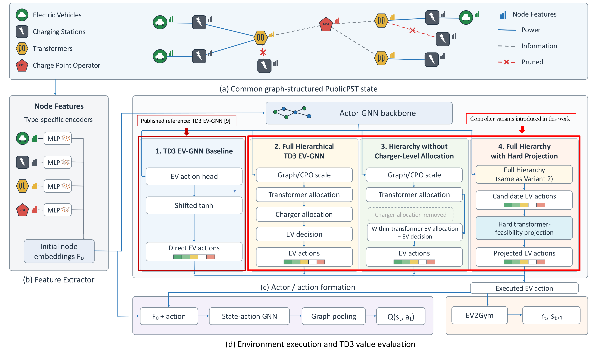
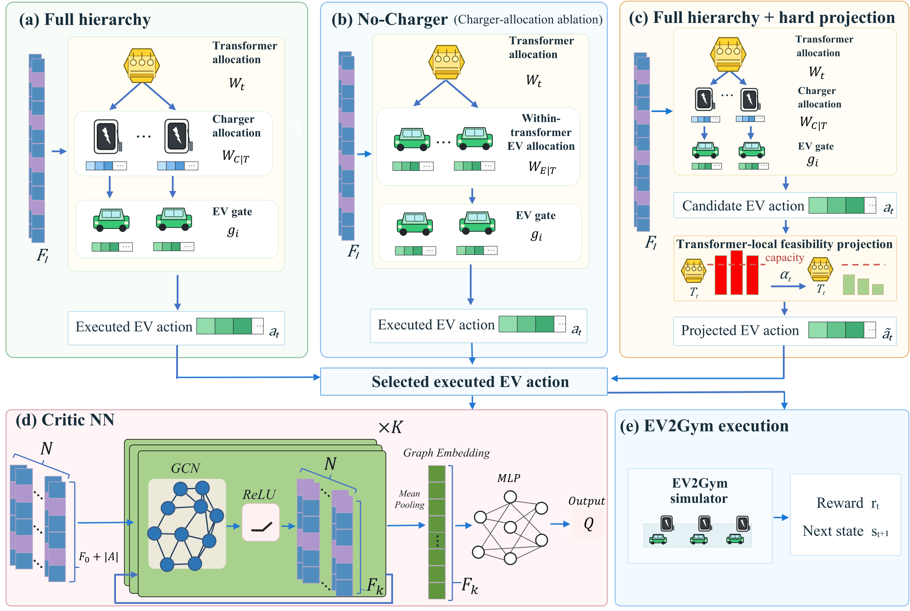
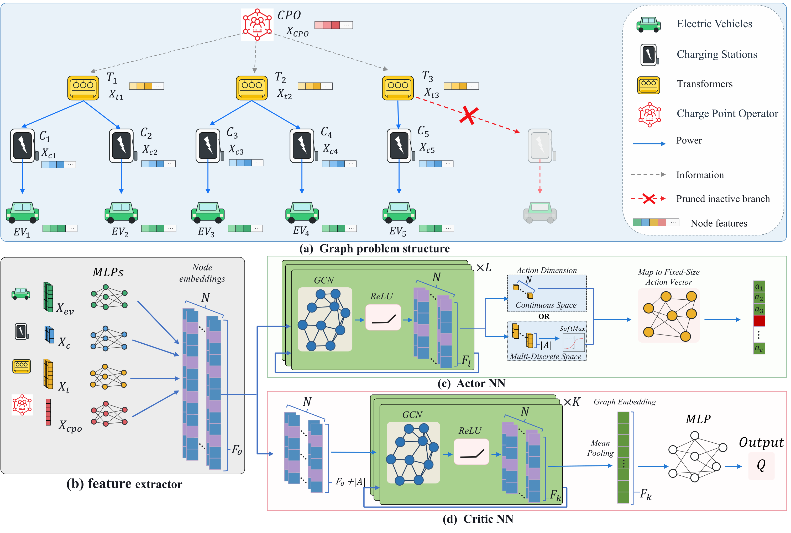

# Hierarchical EV-GNN

Hierarchical graph reinforcement learning for large-scale electric vehicle charging control with infrastructure-aligned action formation and transformer-feasibility projection.

<p align="center">
  
</p>

## Overview

Hierarchical EV-GNN extends the published EV-GNN framework for EV2Gym Public Power Setpoint Tracking (PublicPST). The project keeps the graph-structured representation of the charging network and TD3 actor-critic backbone, while changing how EV charging commands are formed and how transformer-level feasibility is enforced before execution.

The repository provides a common training and evaluation interface for four controller designs:

- **TD3 EV-GNN Baseline** — direct EV-level action formation.
- **Full Hierarchical TD3 EV-GNN** — graph/CPO scaling followed by transformer, charger, and EV-level decisions.
- **Hierarchy without Charger-Level Allocation** — transformer allocation followed by within-transformer EV allocation.
- **Full Hierarchy with Hard Projection** — the full hierarchy followed by deterministic transformer-local feasibility projection.

The implementation is designed around a shared EV2Gym interface so that controller variants can be compared without changing the underlying graph state, critic architecture, or PublicPST environment contract.

## Key Features

- **Infrastructure-aligned control**  
  Organises charging decisions through transformer, charger, and EV levels rather than producing all EV commands directly from the actor head.

- **Controlled architecture ablation**  
  Includes a no-charger variant that removes explicit charger-level allocation while retaining transformer-level allocation and EV-level decisions.

- **Transformer-feasibility projection**  
  Applies proportional transformer-local correction to candidate EV actions before execution when the configured transformer limit would otherwise be exceeded.

- **Shared TD3 workflow**  
  Uses a common training and deterministic evaluation interface across the baseline, hierarchical, ablated, and projected controllers.

- **Multi-scale PublicPST configurations**  
  Supports the retained EV2Gym configuration set, including the 25, 100, 500, and 1000 charging-point settings used in the final study.

## Controller Variants

<p align="center">
  
</p>

| Controller | CLI label | Action formation |
| --- | --- | --- |
| TD3 EV-GNN Baseline | `actiongnn_nonnegative` | Direct EV-level action formation with a non-negative continuous action mapping |
| Full Hierarchical TD3 EV-GNN | `hierarchical` | Graph/CPO scale → transformer allocation → charger allocation → EV decision |
| Hierarchy without Charger-Level Allocation | `hierarchical_transformer_ev` | Graph/CPO scale → transformer allocation → within-transformer EV allocation → EV decision |
| Full Hierarchy + Hard Projection | `hierarchical_transformer_constraint` | Full hierarchy → candidate EV actions → transformer-local feasibility projection |

All formal controller variants retain the same graph-state construction, EV2Gym action interface, and TD3 critic family. The main difference is how graph-informed EV commands are composed before execution.

## Results Snapshot

The final study evaluated four controller designs across 25, 100, 500, and 1000 charging-point PublicPST configurations, with ten independently trained policies per controller-configuration cell and 30 deterministic final-evaluation episodes per selected policy.

For the integrated **Full Hierarchy + Hard Projection** controller relative to the TD3 EV-GNN Baseline:

| Configuration | Mean tracking-error reduction | Satisfaction Δ | Delivered-energy Δ | Mean transformer overload |
| --- | ---: | ---: | ---: | ---: |
| 25CP | 17.3% | −0.39 pp | −3.5% | 0.00 kW-step |
| 100CP | 43.7% | +4.60 pp | +22.8% | 0.00 kW-step |
| 500CP | 33.8% | +2.74 pp | +9.4% | 0.00 kW-step |
| 1000CP | 24.2% | +0.21 pp | −4.2% | 0.00 kW-step |

Across the final projected evaluations, no selected Hard Projection policy recorded a post-projection violation of the configured transformer-capacity limit.

The architecture experiments also showed a clear change in action formation: the hierarchical controllers shifted a substantial share of active-EV commands from maximum-boundary actions toward interior continuous actions, while the charger-allocation ablation retained this characteristic behaviour.

## Installation

The final experiments were run with Python 3.11, PyTorch 2.2.2, PyTorch Geometric, and EV2Gym 1.0.0.

Install the repository dependencies with:

```bash
python -m pip install -r requirements.txt
```

The code expects a working PyTorch Geometric installation compatible with the selected PyTorch environment.

## Quick Start

### Train the TD3 EV-GNN baseline

```bash
python train_td3_gnn.py \
  --algorithm actiongnn_nonnegative \
  --config config_files/PublicPST_25cp.yaml \
  --seed 0 \
  --device cpu \
  --max_timesteps 75000 \
  --start_timesteps 1000 \
  --eval_freq 5000 \
  --eval_episodes 5 \
  --batch_size 64 \
  --replay_buffer_size 100000
```

### Train the full hierarchical controller

```bash
python train_td3_gnn.py \
  --algorithm hierarchical \
  --config config_files/PublicPST_25cp.yaml \
  --seed 0 \
  --device cpu \
  --max_timesteps 75000 \
  --start_timesteps 1000 \
  --eval_freq 5000 \
  --eval_episodes 5 \
  --batch_size 64 \
  --replay_buffer_size 100000
```

### Train the charger-allocation ablation

```bash
python train_td3_gnn.py \
  --algorithm hierarchical_transformer_ev \
  --config config_files/PublicPST_25cp.yaml \
  --seed 0 \
  --device cpu \
  --max_timesteps 75000 \
  --start_timesteps 1000 \
  --eval_freq 5000 \
  --eval_episodes 5 \
  --batch_size 64 \
  --replay_buffer_size 100000
```

### Train the hierarchical controller with hard projection

```bash
python train_td3_gnn.py \
  --algorithm hierarchical_transformer_constraint \
  --config config_files/PublicPST_25cp.yaml \
  --seed 0 \
  --device cpu \
  --max_timesteps 75000 \
  --start_timesteps 1000 \
  --eval_freq 5000 \
  --eval_episodes 5 \
  --batch_size 64 \
  --replay_buffer_size 100000
```

Training outputs are written under `artifacts/experiments/` by default. Each run stores the selected `model.best` checkpoint, the final `model.last` checkpoint, run arguments, configuration metadata, and the training log.

## Evaluation

Use `evaluate_td3_gnn.py` for deterministic evaluation of a trained policy.

Example:

```bash
python evaluate_td3_gnn.py \
  --algorithm hierarchical_transformer_constraint \
  --config config_files/PublicPST_25cp.yaml \
  --seed 0 \
  --eval_episodes 30 \
  --checkpoint artifacts/experiments/<run_name>/model.best \
  --output_csv results/evaluation.csv \
  --device cpu \
  --deterministic true
```

The charging-point scale is selected by the EV2Gym configuration file. The evaluator uses the checkpoint metadata and saved training arguments associated with the selected run.

For the complete command-line options:

```bash
python train_td3_gnn.py --help
python evaluate_td3_gnn.py --help
```

## Configuration

All retained EV2Gym configuration files remain under:

```text
config_files/
```

The repository intentionally keeps the complete configuration set used throughout development and evaluation. The final multi-scale PublicPST study uses scale-specific configurations for 25, 100, 500, and 1000 charging points.

## Repository Structure

```text
Hierarchical-EV-GNN/
├── assets/
│   └── figures/
│       ├── architecture_overview.png
│       ├── controller_designs.png
│       ├── evgnn_reference_architecture.png
│       └── source/
│           ├── architecture_overview.pdf
│           ├── controller_designs.pdf
│           └── evgnn_reference_architecture.pdf
│
├── config_files/                         # EV2Gym configuration set
│
├── TD3/
│   ├── TD3_ActionGNN_Controlled.py
│   ├── TD3_ActionGNN_NonNegative.py
│   ├── TD3_HierarchicalActionGNN.py
│   ├── TD3_HierarchicalActionGNN_TransformerConstraint.py
│   └── TD3_TransformerEVActionGNN.py
│
├── utils/
│   ├── ev2gym_training_utils.py
│   ├── replay_buffer_actiongnn.py
│   ├── state_public_pst_gnn.py
│   └── transformer_feasibility_projection.py
│
├── train_td3_gnn.py                     # Training entry point
├── evaluate_td3_gnn.py                  # Deterministic evaluation
├── requirements.txt
└── README.md
```

Large experiment outputs, checkpoints, research notebooks, HPC workflow files, diagnostics, and development-only utilities are intentionally kept outside the public release branch.

## EV-GNN Foundation

This project builds on the EV-GNN framework introduced by Orfanoudakis et al. The published reference architecture represents the charge point operator, transformers, charging stations, and EVs as a heterogeneous graph and uses graph neural networks in both the actor and critic.

<details>
<summary>Reference TD3 EV-GNN architecture</summary>

<br>

<p align="center">
  
</p>

</details>

### Upstream EV-GNN

S. Orfanoudakis, V. Robu, E. M. Salazar, P. Palensky, and P. P. Vergara,  
**“Scalable reinforcement learning for large-scale coordination of electric vehicles using graph neural networks,”**  
*Communications Engineering*, vol. 4, Art. no. 118, 2025.  
DOI: https://doi.org/10.1038/s44172-025-00457-8

Original repository: https://github.com/StavrosOrf/EV-GNN

### TD3

S. Fujimoto, H. van Hoof, and D. Meger,  
**“Addressing Function Approximation Error in Actor-Critic Methods,”**  
Proceedings of the 35th International Conference on Machine Learning, 2018.  
https://arxiv.org/abs/1802.09477

## Associated Research

This repository accompanies:

**Hierarchical EV-GNN with Hard Transformer-Feasibility Projection for Large-Scale Electric Vehicle Charging Control**  
Chia Yang Chen, Monash University, 2026.

The research evaluates hierarchical action organisation, charger-level allocation, and deterministic transformer-feasibility projection under EV2Gym PublicPST.

## Citation

If you use this implementation, please cite the associated research work when its public bibliographic record is available, together with the upstream EV-GNN paper where appropriate.

```bibtex
@misc{chen2026hierarchicalevgnn,
  author = {Chia Yang Chen},
  title = {Hierarchical EV-GNN with Hard Transformer-Feasibility Projection for Large-Scale Electric Vehicle Charging Control},
  year = {2026},
  institution = {Monash University}
}
```

## Acknowledgements

This work was developed at Monash University and builds on the EV-GNN and EV2Gym research ecosystems.

The repository focuses on the final controller implementation and public-facing training/evaluation workflow. Development artefacts and full experiment archives are retained separately from the release branch.
